# d3-three

Eighteen charts from the [D3 gallery](https://observablehq.com/@d3/gallery)
ported to [three.js](https://threejs.org) `WebGPURenderer`. d3's layout
modules (d3-hierarchy, d3-shape, d3-scale, d3-force, d3-force-3d, d3-geo,
d3-chord, d3-sankey) still compute the layout. The DOM half of d3 (selection,
transition, zoom, drag) is replaced by Three objects, an orbit camera and
raycasting. Where a third axis helps, the layout is lifted into 3D (a cone
tree, nodes on a sphere, d3-force-3d). Where it does not, the 2D chart is drawn
flat inside the 3D world and can still be orbited.

Each page is graded by an end-to-end harness copied from three.js's own
(`test/e2e/`). It renders the page headless and diffs the frame against a
committed screenshot. It also checks that the scene is faithful to the data.

Formerly called d33.

## The pages

| | | |
| --- | --- | --- |
| [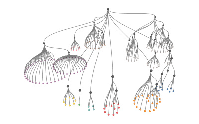](examples/d3_cluster.html)<br>cluster dendrogram → cone tree | [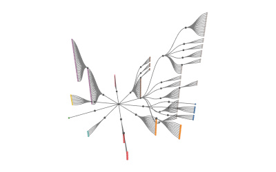](examples/d3_tree.html)<br>tidy tree → radial fan of tidy planes | [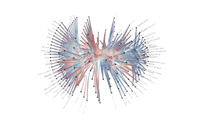](examples/d3_bundling.html)<br>hierarchical edge bundling → sphere |
| [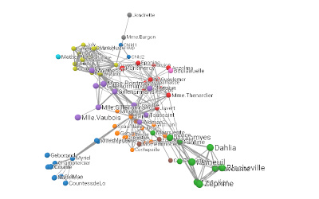](examples/d3_force.html)<br>force-directed graph → d3-force-3d | [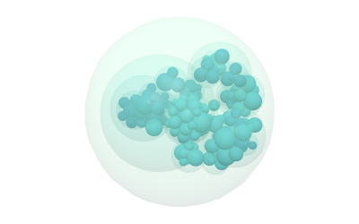](examples/d3_pack.html)<br>circle packing → sphere packing | [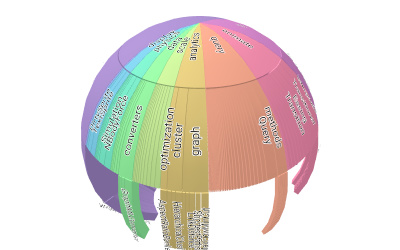](examples/d3_sunburst.html)<br>sunburst (flat) |
| [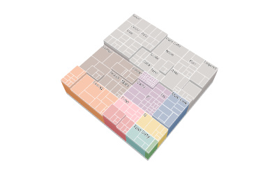](examples/d3_treemap.html)<br>treemap (flat) | [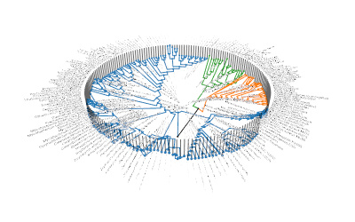](examples/d3_tree-of-life.html)<br>tree of life → cylinder | [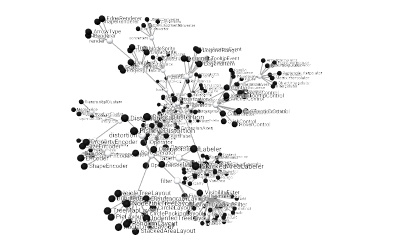](examples/d3_force-tree.html)<br>force-directed tree → d3-force-3d |
| [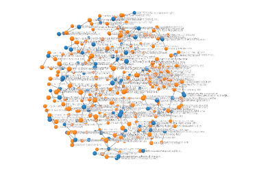](examples/d3_disjoint.html)<br>disjoint force-directed graph → d3-force-3d | [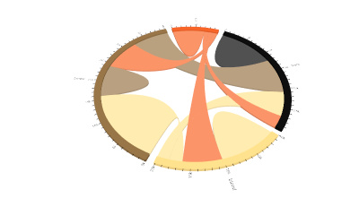](examples/d3_chord.html)<br>chord diagram (flat) | [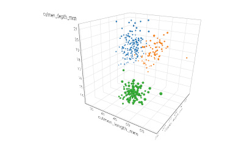](examples/d3_splom.html)<br>scatterplot matrix → one 3D scatter |
| [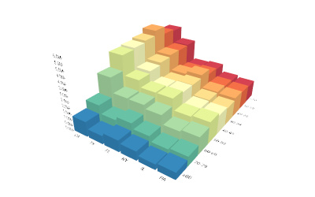](examples/d3_grouped-bars.html)<br>grouped bar chart → bar matrix | [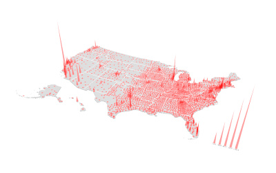](examples/d3_spikes.html)<br>spike map, spikes standing up | [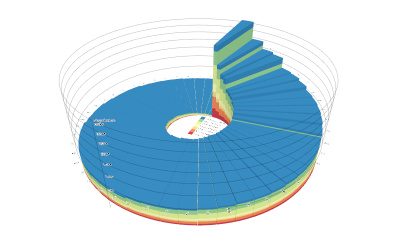](examples/d3_radial-bars.html)<br>radial stacked bars, stacks lifted |
| [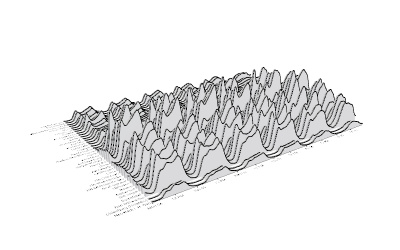](examples/d3_ridgeline.html)<br>ridgeline plot, series along z | [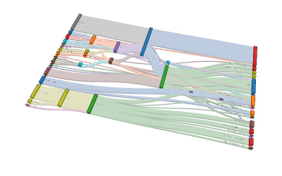](examples/d3_sankey.html)<br>sankey (flat) | [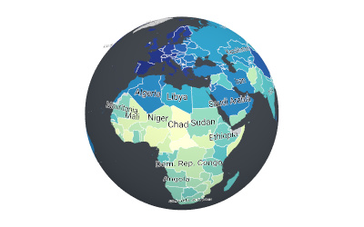](examples/d3_globe.html)<br>world choropleth → globe |

`examples/d3_blank.html` is a test fixture rather than a chart. It proves the
gates fail on an empty scene, and an unfiltered `npm run e2e` skips it.

Each page also has a layout note in `layouts/<slug>.md` describing its 3D
layout. `ref/<slug>.png` is the original notebook rendered by `tools/ref.js`,
kept as a visual anchor.

## Setup

Node 24 and Linux were used to build this. The harness drives the Chromium
that puppeteer 25.9.0 installs, and WebGPU runs on Dawn's software
SwiftShader adapter, which is what keeps the frames reproducible.

```bash
npm ci
export THREE_DIR=/path/to/three.js
export GALLERY_DIR=/path/to/d3-gallery/notebooks
```

- **`THREE_DIR`** is a three.js tree containing `build/three.webgpu.js`,
  `build/three.tsl.js`, `build/three.module.js` and `examples/jsm/`. A clone
  of [mrdoob/three.js](https://github.com/mrdoob/three.js) works, and so does
  the unpacked npm package (`npm pack three@0.186.1`). The committed
  screenshots pass at 0.0% against both three@0.186.1 and the dev branch at
  `5f610f5`.
- **`GALLERY_DIR`** holds the gallery notebooks' file attachments, laid out
  as `<section>/<slug>/files/<name>`. The pages fetch these paths:

```
hierarchies/{cluster.v2,tree.v2,treemap.v2}/files/flare.json
hierarchies/{pack.v2,sunburst.v2,force-directed-tree}/files/flare-2.json
networks/hierarchical-edge-bundling.v2/files/flare.json
networks/force-directed-graph.v2/files/miserables.json
networks/disjoint-force-directed-graph.v2/files/graph.json
networks/sankey.v2/files/energy.csv
dots/splom.v2/files/penguins.csv
dots/spike-map.v2/files/{counties-albers-10m.json,population.json}
bars/grouped-bar-chart.v2/files/us-population-state-age.csv
radial/radial-stacked-bar-chart.v3/files/data-2.csv
areas/ridgeline-plot/files/traffic.csv
maps/world-choropleth.v2/files/{countries-50m.json,hale.csv}
```

  Each directory corresponds to a notebook such as `@d3/cluster/2`. Observable's
  export API (`https://api.observablehq.com/@d3/cluster/2.js?v=4`) lists each
  attachment's download URL. The tree of life's Newick file is committed at
  `examples/data/life.txt`, and the chord diagram's data is inline.

## Running

```bash
npm run serve        # http://localhost:1234/examples/d3_cluster.html
npm run e2e          # grade every page; e2e d3_tree grades one
npm run e2e:make     # rewrite examples/screenshots/ from the current render
npm run e2e:twice    # render each page twice and require 0 differing pixels
npm run determinism  # check the injected Math.random, clocks and RAF
npm test             # layout invariants for src/pack3.js (needs GALLERY_DIR)
```

The server mounts this repo at `/`, `$THREE_DIR/build` at `/build/`,
`$THREE_DIR/examples/jsm` at `/jsm/`, `$GALLERY_DIR` at `/gallery/` and the
lib3 package's `dist/` at `/lib3/`. Each page's importmap resolves `three`,
`three/addons/`, `d3` and `lib3/sdf-text` against those mounts. Open the pages
in a WebGPU browser to orbit them.

`npm run e2e` loads each page under three.js's `deterministic-injection.js`,
which seeds `Math.random`, freezes the clocks and fires one animation frame.
Each frame is captured at 400×250 and compared with
`examples/screenshots/d3_<slug>.jpg` using three's `image.js`. A page fails
if more than 0.1% of its pixels differ, the same threshold three.js uses. The
harness then calls `window.d3three.report()` on the page and writes
`marks/d3_<slug>.json` and `gates/d3_<slug>.json`. A failed gate fails the
page the same way a pixel diff does:

- **depth**: the smallest axis extent of the mark positions is at least a
  quarter of the largest. Planar pages report this ratio but are exempt.
- **counts**: one scene object per datum, and the node and link counts equal
  the d3 hierarchy's `descendants()` and `links()`.
- **angle**: the marks cover a non-degenerate area seen from the page camera
  and from a second camera rotated 90°.
- **picking**: raycasting from a node's own pixel hits that node, from both
  cameras.
- **labels**: one label per labelled datum.

## The ladder

The work was built as a ladder of rungs, each one small enough to finish and
grade before the next began. Rung 0 copied the harness and proved the
injection was deterministic, with a blank page that fails the gates. Rungs 1
and 2 were the cluster dendrogram and the tidy tree, and they grew the shared
primitives in `src/`: node marks, links, framing and the orbit camera. Rung 3
added text labels through lib3's SDF text. After that the shared code was
frozen, and each further chart was built on its own branch, which added files
only, before being merged back.

Every finished rung leaves five things behind: the page, its screenshot, its
marks and gates JSON, its layout note, and an entry in
`handoff/LADDER-FOR-THREE-RS.md` listing the d3 modules the chart needs and
summarising its 3D layout. The briefs and logs for the rungs are in
`handoff/`.

## Related projects

- **[lib3](https://www.npmjs.com/package/@oneilltom/lib3)**
  (`@oneilltom/lib3`, MIT) provides the labels. Its `sdf-text` module
  (`BatchedText`, `Text`) renders SDF glyphs from
  `examples/fonts/Roboto-Regular.ttf`, and `src/labels.js` builds on it.
- **[three-rs](https://github.com/oneilltomhq/three-rs)** is a Rust port of
  three.js and `WebGPURenderer` on wgpu, graded by three.js's own e2e
  screenshots. three-rs grades against references that already exist, and
  d3-three creates references for it to grade against later. three-rs
  renders on a different rasterizer, so it cannot match these screenshots
  pixel for pixel. Its contract is `marks/d3_<slug>.json` instead: every
  datum's world position, link endpoints, and label pose.
  `handoff/LADDER-FOR-THREE-RS.md` is written for the port.

## Licence

MIT, see `LICENSE`. Some files come from other projects under their own
licences:

- `examples/jsm/vendor/d3.js` is an esbuild bundle of d3 7 (ISC) with
  d3-force-3d (MIT), built by `npm run build:d3`.
- `examples/jsm/vendor/d3-sankey.js` and `src/vendor/d3-sankey/` are
  d3-sankey 0.12.3 (BSD-3-Clause, see `src/vendor/d3-sankey/LICENSE`).
- `examples/jsm/vendor/topojson-client.js` is topojson-client 3.1.0 (ISC).
- `examples/fonts/Roboto-Regular.ttf` is Roboto 2.001047, Copyright 2015
  Google Inc. (Apache-2.0).
- `test/e2e/image.js`, `deterministic-injection.js` and `clean-page.js` were
  copied from three.js (MIT), and `puppeteer.js` and `server.js` were adapted
  from it.
- The pages port code from the D3 gallery notebooks (ISC, Copyright
  Observable, Inc.; @d3/tree-of-life is Copyright Mike Bostock), and
  `parseNewick` in `examples/d3_tree-of-life.html` is Jason Davies's
  newick.js (MIT).

The full licence texts and notices are in
`examples/jsm/vendor/THIRD-PARTY-NOTICES.md`, `LICENSE-Roboto` and
`LICENSE-three.js`.
